# InsurEdge Insurance CRM & AI Automation
## Sales Pitch, Problem Landscape & Value Proposition Guide

> **Document Version:** 2.5 (claims-corrected, 21 Oct 2026) | **Target Audience:** Agency Principals, Sales Executives, Venture Partners, Agency Operations Directors
> **Platform:** Multi-tenant insurance agency CRM, workflow automation and guardrailed AI agents
> **Repository Base:** `c:\xampp\htdocs\crm` (Laravel 12 API + Next.js 15 App Router + Anthropic Claude via a configurable LLM driver)
> **Evidence:** every product claim in this document is mapped to code, tests or a cited source in [`sales-claims-evidence.md`](sales-claims-evidence.md). Anything not yet built is listed under [Roadmap](#10-roadmap-not-yet-available).

### Ground rules for anyone using this document

1. **We have no customer results yet.** Every conversion, time-saving or ROI figure here is a **target outcome (modelled estimate)**, not a measured result. Say so when you use it.
2. **Roadmap items are not features.** Do not demo, promise or price anything in section 10 as available today.
3. **Messaging providers are not wired yet.** Email and SMS currently use log drivers (`api/config/crm.php`, `messaging.*_driver = log`); Twilio and SendGrid adapters are listed as "planned" in the integration catalog. Automated messages are queued, consent-checked and logged, but live SMS/email delivery, and therefore any "speed-to-lead in 60 seconds via SMS" claim, is a **target** until an adapter ships.
4. **Pricing to be confirmed (docs/pricing.md pending).** Every price in this document carries that label.

---

## Visual Platform Overview

| Platform Dashboard (concept) | Visual Workflow Engine (concept) |
| :---: | :---: |
|  |  |
| *Concept illustration, not a product screenshot. All figures shown are illustrative.* | *Concept illustration, not a product screenshot. Counts and percentages shown are illustrative.* |

---

## Table of Contents
1. [Executive Summary](#1-executive-summary)
2. [The Core Problem Landscape We Are Solving](#2-the-core-problem-landscape-we-are-solving)
3. [The Solution: InsurEdge AI Automation & Insurance CRM](#3-the-solution-insuredge-ai-automation--insurance-crm)
4. [The Sales Pitch Framework](#4-the-sales-pitch-framework)
5. [InsurEdge Differentiators](#5-insuredge-differentiators)
6. [Target Personas & Value Proposition](#6-target-personas--value-proposition)
7. [Economic Business Case & ROI Model (modelled estimates)](#7-economic-business-case--roi-model-modelled-estimates)
8. [Objection Handling Playbook](#8-objection-handling-playbook)
9. [Packaging, Pricing & Implementation Plan](#9-packaging-pricing--implementation-plan)
10. [Roadmap (not yet available)](#10-roadmap-not-yet-available)
11. [Change log](#change-log)

---

## 1. Executive Summary

Insurance distribution has a lead-response problem. Agencies pay for web inquiries, aggregator leads and referral campaigns, yet many of those leads are contacted late or not at all.

Industry studies suggest response speed matters a great deal:
- The **Lead Response Management Study** (Dr. James Oldroyd, MIT, with InsideSales.com, 2007) found the odds of **qualifying** a lead were **21x higher** when it was contacted within 5 minutes rather than 30 minutes.
- **Harvard Business Review**, "The Short Life of Online Sales Leads" (Oldroyd, McElheran & Elkington, March 2011), found firms that tried to contact a lead within an hour were **nearly 7x as likely to qualify it** as firms that waited even one hour longer, and that the average first response across the 2,241 US firms audited was **42 hours**.

These studies are cross-industry, not insurance-specific.

Agencies typically juggle a back-office agency management system, a separate CRM or spreadsheet, and separate texting, e-signature and payment tools. Generic CRMs lack insurance data such as vehicles, drivers, X-dates and end-of-day balancing, and unconstrained AI chatbots add compliance risk: invented rates, exposure of personal data, and messages sent outside permitted hours.

**InsurEdge brings these into one multi-tenant platform** built on Laravel 12 (API), Next.js 15 / React 19 (web) and **Anthropic Claude (model configurable per agent)**. It combines:
1. **Lead intake and routing**: API-key and signed-webhook intake, CSV import, website quote widget, contact de-duplication, rules-based scoring, and routing by round robin, capacity or skills into a work queue.
2. **Visual workflow automation**: a drag-and-drop canvas with 11 actions, conditions, delays, event waits, approval steps, stop conditions, dry runs and an idempotent transactional outbox.
3. **Guardrailed AI agents**: PII redaction before every model call, per-agent token limits and a monthly token budget, JSON-schema output validation, a tool allow-list with human approval for proposed actions, and publishing blocked below the workspace evaluation pass threshold (default 80%).
4. **Agency operations**: insurance details (vehicles, drivers), quote requests, policies and renewals, X-dates, receipts and end-of-day closeout, claims, time clock, double-entry accounting, commissions, carrier download files, ACORD-style forms with e-signature, and card payments.

**Target outcomes (modelled estimates, not customer results):** higher lead-to-policy conversion through faster, consistent follow-up and less producer admin time. See section 7 for the model and its assumptions. Compliance is supported by **built-in compliance controls** (consent checks before every send, suppression, opt-out keywords, a configurable quiet-hours window). These help an agency comply but do not by themselves guarantee TCPA or CAN-SPAM compliance.

---

## 2. The Core Problem Landscape We Are Solving

### Problem 1: Slow lead response

When a prospect requests a quote online they are usually shopping several agencies at once. Industry studies suggest the first agency to make meaningful contact has a large advantage (see the Lead Response Management Study and HBR 2011, cited in section 1). Common gaps in agencies:

| Gap | What it looks like | Business consequence |
|---|---|---|
| **Slow first response** | Web leads wait in a shared inbox for hours | Prospects talk to a faster competitor first |
| **No off-hours coverage** | Friday-evening leads wait until Monday | Paid leads go cold |
| **Inconsistent follow-up** | One or two manual attempts, then nothing | Acquisition spend with little pipeline return |

> **Key research finding (cited):** the Lead Response Management Study (MIT / InsideSales.com, 2007) found qualifying odds were 21x higher at 5 minutes than at 30 minutes, and HBR (2011) found contact within the first hour was nearly 7x more effective than contact an hour later, with effectiveness falling further over the following day.

### Problem 2: Systems not built for real-time sales

Many agencies run their book on back-office systems designed around accounting and policy records rather than real-time lead response. Typical symptoms:
- Leads from landing pages and aggregators arrive by email or CSV and are re-typed.
- Follow-up sequences need third-party tools or custom scripts.
- Sales activity, policies, cash and commissions live in different systems.

*(Competitor-specific claims about named vendors have been removed from this document; see the change log.)*

### Problem 3: AI risk and liability

Unconstrained generative AI creates real risk for an insurance agency:
- **Invented insurance advice or premiums**, which can create Errors & Omissions exposure.
- **Personal data exposure:** applications contain dates of birth, driver's licence numbers, VINs and sometimes SSNs. Sending raw personal data to an external model raises privacy and regulatory concerns (for example under GLBA and state insurance data-security rules).
- **Uncontrolled token costs** from unbounded prompts or loops.

### Problem 4: TCPA and messaging rules

- **Telephone Consumer Protection Act (TCPA):** statutory damages are **$500 per violation, up to $1,500 if willful**. Texting without the required consent, or after an opt-out, creates class-action exposure.
- **Calling-time rules:** federal TCPA rules bar telephone solicitations before 8 AM or after 9 PM at the called party's location; some states set stricter windows.
- **Suppression failures:** when consent is revoked, disconnected tools may keep sending from another system.

### Problem 5: Administrative load on producers

Producers lose selling time to duplicate data entry, chasing renewal dates in spreadsheets, re-keying carrier data, typing routine follow-ups and balancing the daily cash drawer. Industry commentary suggests this is a large share of the working day; we have not measured it and do not quote a figure.

---

## 3. The Solution: InsurEdge AI Automation & Insurance CRM

The platform targets the five problems above with controls built into the product, not bolted on.

### Core Architecture & Technology Stack

```mermaid
flowchart TD
    subgraph INTAKE["1. Intake"]
        Web[Website quote widget & hosted quote page]
        Agg[Aggregators & partners via API key]
        CSV[Bulk CSV lead import]
        Webhook[Signed inbound webhooks / REST API]
    end

    subgraph ENGINE["2. Core engine & guardrails"]
        Tenant[Tenant isolation: global scoping + tests]
        Dedupe[Contact de-duplication]
        PII[PII redactor before LLM calls]
        Rules[Rules-based scoring & routing]
        Workflow[Visual workflow engine & transactional outbox]
        AI[Anthropic Claude agent runner - model per agent]
        Consent[Consent, suppression & quiet-hours gate]
    end

    subgraph ACTIONS["3. Actions"]
        SMS[SMS - provider adapter on roadmap; log driver today]
        Email[Template email - provider adapter on roadmap; log driver today]
        Tasks[Automated task creation]
        Pool[Work queue & round robin]
        Approval[Human approval step]
    end

    subgraph AGENCY["4. Agency operations"]
        Quotes[Quote requests]
        Policies[Policies & book of business]
        Renewals[Renewals & X-dates]
        EOD[Receipts & end-of-day closeout]
        Claims[Claims log & audit trail]
    end

    INTAKE --> ENGINE
    ENGINE --> ACTIONS
    ACTIONS --> AGENCY
```



### The 6 Pillars of the Platform

#### Pillar 1: Lead intake, routing & work queue
- **Intake:** API keys with scopes (`leads:create` and others), signed inbound webhooks, CSV import with per-row error reporting, and an embeddable website quote widget with a hosted quote page. Contacts are normalized and re-used; a repeat open lead is flagged as a duplicate. Intake supports idempotency keys.
- **Routing:** round robin (row-locked cursor), capacity (maximum open leads), skills (for example licensed states, product lines, languages), or a fixed user or team. Only members marked available are chosen.
- **Work queue (lead pool):** leads are served one at a time with an atomic claim, so two agents never get the same lead; follow-ups return to their owner or to a teammate when the owner is offline. Presence, dispositions and a leaderboard are included.

#### Pillar 2: Visual workflow automation
- **Workflow canvas** built with `@xyflow/react`, so managers can build automations without code.
- **11 actions:** `lead.assign`, `lead.update_field`, `lead.change_stage`, `lead.add_tag`, `lead.activity.create`, `lead.score`, `task.create`, `message.send_template`, `ai.run_agent`, `notification.send`, `insurance.quote_request`.
- **Step types:** condition, action, delay, wait-for-event, approval, exit.
- **Execution safeguards:**
  - A transactional outbox writes events in the same database transaction as the business change; delivery is at-least-once, and duplicate trigger deliveries do not start a second execution.
  - **Dry-run mode** previews a workflow with no side effects.
  - **Stop conditions** halt a running workflow when the lead replies, books an appointment, revokes consent or converts. *(Known gap: one conversion path does not yet emit `lead.converted`; see audit P2-1.)*
  - Long delays are parked in the database and resumed; published versions are immutable.

#### Pillar 3: AI agents with guardrails
- **AI does not set rates.** Agents handle intake support, summaries and drafting. Pricing is never generated by the model, and quotes are confirmed only by a verified provider webhook or manual entry.
- **PII redaction:** the redactor removes sensitive keys (for example SSN, licence number, date of birth, card number, email, phone) and pattern-matches SSNs, card numbers and phone numbers before a prompt is sent. *Coverage is being extended (names, addresses, more date formats and keys; audit P1-2/P1-3). Do not claim that no personal data ever reaches the model.*
- **Token limits:** a per-agent `max_tokens` limit on every call, plus a monthly AI token budget per plan; a run that would exceed the budget is stopped.
- **Structured output:** responses are validated against the agent's JSON schema, with one automatic retry before the run fails.
- **Tool allow-list:** the model can only *propose* actions from its allow-list; proposals become approval requests unless the tool is explicitly auto-approved.
- **Evaluation gate:** managers define evaluation cases per agent. When an agent has evaluation cases, **publishing is blocked below the workspace pass threshold (default 80%)**, and a version cannot be published until it has been evaluated.
- **Model choice:** Anthropic Claude, **model configurable per agent version** from the models enabled in `config/crm.php` (currently `claude-opus-5-5` (default), `claude-sonnet-5-5`, `claude-haiku-5-5`).

#### Pillar 4: Human-in-the-loop approvals
- Any workflow can include an **approval step**, and AI tool proposals become approval requests.
- Managers decide in the **Approvals** screen (`/approvals`). *(Gaps: no self-approval guard and no endpoint tests yet; audit item 8.)*
- End-of-day closeouts require manager review by default, and employee commission statements are approved before payment.

#### Pillar 5: Built-in compliance controls
- **Consent before every send:** consent is a history of channel and purpose decisions and is re-checked immediately before each message is sent. A lead being in the database is never treated as consent.
- **Quiet hours:** a **configurable quiet-hours window, default 8 AM–9 PM**, applied to SMS and voice in the **contact's time zone when it is recorded** (otherwise the workspace time zone). A message blocked by quiet hours is held and retried when the window next opens. *Per-state quiet-hour rules are on the Roadmap.*
- **Opt-out keywords:** an inbound STOP, STOPALL, UNSUBSCRIBE, CANCEL, END or QUIT revokes consent on that channel for every purpose and adds the destination to the suppression list. Workflows that list `consent.revoked` as a stop condition halt.
- **Consent history:** each record stores channel, purpose, status, source, evidence reference, jurisdiction, who recorded it and when. *(Known gap: contact merge can currently move consent records between contacts; audit P1-1.)*

#### Pillar 6: Agency operations & back office
- **Insurance data:** vehicles, drivers and per-line details for auto, home, renters, life, health, commercial, umbrella and other lines (life and health are line values only; structured capture covers auto and home basics).
- **Renewals & X-dates:** a daily sweep creates renewal tasks a configurable number of days before expiration (default 45), fires a `policy.renewal_due` event that workflows can use for outreach, expires lapsed policies, and returns X-date prospects to the work queue 30 days ahead.
- **Cash:** numbered receipts, end-of-day closeout with cash reconciliation and manager review, carrier sweep upload reconciled against receipts.
- **Accounting:** chart of accounts, double-entry journal, deposits, payables and checks, invoices, expenses and petty cash, financial statements and year-end close.
- **Commissions:** carrier statement import and reconciliation, employee commission plans with splits and overrides, premium finance.
- **Carrier downloads:** upload CSV, ACORD XML or basic AL3 files; transactions are matched to policies, with an exceptions queue and producer-code mapping. *(Live IVANS connection: Roadmap.)*
- **Forms & e-sign:** ACORD-style form library (look-alike structured forms; official ACORD forms are licensed), prefill from contact and policy, print, and one-time public e-signature links.
- **Card payments:** card gateway (CardConnect; Kurv placeholder), payment links and receipts. *Hosted card tokenization is being added so card numbers no longer pass through our servers (audit P0-1); until then, do not describe the payment flow as PCI-scope-reducing.*
- **Also included:** claims log, time clock, Rolodex, announcements, mail/letter blasts, agency reports, knowledge base with cited answers, and white-label themes per instance.

---

### End-to-End Insurance Lead Lifecycle
#### From first inbound click to annual renewal

The walkthrough below shows how an inquiry moves through the platform today. Steps or parts marked **(Roadmap)** are not built.

```mermaid
flowchart TD
    classDef source fill:#1e293b,stroke:#38bdf8,stroke-width:2px,color:#f8fafc;
    classDef module fill:#0f172a,stroke:#2563eb,stroke-width:2px,color:#f8fafc;
    classDef ai fill:#092e20,stroke:#10b981,stroke-width:2px,color:#f8fafc;
    classDef gate fill:#3b1e08,stroke:#f59e0b,stroke-width:2px,color:#f8fafc;
    classDef bound fill:#1e1b4b,stroke:#818cf8,stroke-width:2px,color:#f8fafc;

    subgraph S1["STAGE 1: LEAD CAPTURE & INTAKE"]
        A["Inbound sources (website widget, partner API, aggregators via API/webhook, CSV)"]:::source
        A -->|Signed Webhook / API Key| B["Integrations & API intake (/integrations, /settings/api-keys)"]:::module
    end

    subgraph S2["STAGE 2: DEDUPLICATION & CONSENT"]
        B -->|Re-use contact by phone & email| C["CRM Core (/leads)"]:::module
        C -->|Record consent: source, evidence, time| D["Consent & Suppression (/settings/consent)"]:::module
    end

    subgraph S3["STAGE 3: SCORING & AI ASSIST"]
        D -->|Rules-based lead score| E["Lead score"]:::module
        E -->|PII redaction, then Anthropic Claude (model per agent)| F["AI Agents (/agents)"]:::ai
        F -->|Proposed actions need approval unless auto-approved| G["Lead detail: insurance details"]:::ai
    end

    subgraph S4["STAGE 4: ROUTING & WORK QUEUE"]
        G -->|Round robin / capacity / skills| H["Routing rules (/settings/routing)"]:::module
        H -->|Row-locked round-robin cursor| I["Work queue (/work)"]:::module
        I -->|Assigned producer| J["Assigned producer (/leads)"]:::module
    end

    subgraph S5["STAGE 5: WORKFLOW & FIRST TOUCH"]
        J -->|Domain event: lead.assigned| K["Workflows (/workflows)"]:::module
        K -->|Consent + quiet-hours window (default 8am-9pm)| L["Communications (/inbox, /templates)"]:::module
        L -->|Outbox-queued SMS & email - live delivery is Roadmap| M["Acknowledgement message (target: under 60s)"]:::source
        K -->|Auto-create follow-up task| N["Tasks (/tasks)"]:::module
    end

    subgraph S6["STAGE 6: PRODUCER ACTION"]
        N -->|In-app notification| O["Notifications (/notifications)"]:::module
        O -->|Open timeline & lead file| P["Lead detail (/leads/[id])"]:::module
        P -->|Call logged (click-to-call is Roadmap)| Q["Call log (/calls)"]:::module
        P -->|Move stage on Kanban| R["Pipelines (/pipelines)"]:::module
    end

    subgraph S7["STAGE 7: QUOTING & APPROVAL"]
        R -->|Record carrier quotes| S["Quote requests (/insurance/quotes)"]:::module
        S -->|Workflow approval step| T["Approvals (/approvals)"]:::gate
        T -->|Approved| U["Form sent for e-signature (/forms)"]:::source
    end

    subgraph S8["STAGE 8: POLICY & BOOK OF BUSINESS"]
        U -->|Staff convert lead to policy| V["Policy created"]:::bound
        V -->|Book of business| W["Policies (/policies)"]:::bound
        W -->|Customer record| X["Contacts (/contacts)"]:::bound
    end

    subgraph S9["STAGE 9: RECEIPTS & END OF DAY"]
        W -->|Receipt or card payment| Y["Receipts (/receipts)"]:::module
        Y -->|Close out cash, checks, cards| Z["End of day (/eod)"]:::module
        Z -->|Reconcile carrier sweep file| AA["Sweeps (/sweeps)"]:::module
    end

    subgraph S10["STAGE 10: RENEWALS, CLAIMS & REPORTING"]
        W -->|Daily sweep: renewal task (default 45 days), X-dates (30 days)| AB["Renewals & X-dates (/renewals)"]:::bound
        AB -->|Retention mailings| AC["Blasts (/blasts)"]:::module
        W -->|Log a claim| AD["Claims (/claims)"]:::module
        AD -->|Response time, SLA breaches, conversion| AE["Reports (/reports)"]:::module
    end
```

#### The 10-Step Operational Lifecycle Walkthrough

| Step | Flow | Screens | Engine & event | User experience | Safeguards |
|---|:---:|---|---|---|---|
| **1: Capture** | `Prospect submits` ➔ `Intake` ➔ `Lead` | [Integrations](/integrations) · [API keys](/settings/api-keys) · website widget | Inbound webhooks verified by HMAC-SHA256 signature; API keys stored as SHA-256 hashes with scopes; `lead.created` recorded in the outbox. | Lead appears without manual typing. | Throttled intake endpoints; request validation; idempotency keys; honeypot and rate limit on the website form. |
| **2: De-dupe & consent** | `Raw lead` ➔ `Contact match` ➔ `Consent record` | [Leads](/leads) · [Consent](/settings/consent) | Contact matched on normalized email and phone and re-used; a repeat open lead is flagged as a duplicate; consent recorded with source, evidence reference and time. | No duplicate contact is created. | Consent is required before any message; presence in the database is not consent. |
| **3: Score & AI assist** | `Lead` ➔ `Rules score` ➔ `Redactor` ➔ `Claude agent` | [AI Agents](/agents) · lead detail | Rules-based score (for example: has email, has phone, product stated, consent on file). Optional AI agent run on redacted input with schema-validated output. | Score and AI summary on the lead. | PII redaction (coverage being extended), per-agent token limit, monthly budget, tool allow-list. |
| **4: Routing** | `Lead` ➔ `Rule` ➔ `Round robin` ➔ `Producer` | [Routing](/settings/routing) · [Work queue](/work) | Rules choose round robin, capacity, skills or a fixed user or team; round robin uses a row-locked cursor. | Lead is served to the producer in the work queue. | Routing is rules-based; AI does not make routing decisions. |
| **5: Workflow & outbox** | `lead.assigned` ➔ `Workflow` ➔ `Consent & quiet hours` ➔ `Message` | [Workflows](/workflows) · [Inbox](/inbox) | Send job re-checks consent and suppression and applies the quiet-hours window (default 8 AM–9 PM, contact time zone if recorded). **Live SMS/email delivery is Roadmap (log drivers today); target first touch under 60 seconds.** | Message and auto-created task appear on the lead timeline. | Quiet hours enforced at send time; STOP opt-out and suppression. |
| **6: Producer engagement** | `Notification` ➔ `Call / message` ➔ `Advance stage` | [Pipelines](/pipelines) · [Calls](/calls) · [Tasks](/tasks) | Calls are logged from provider webhooks. **Click-to-call / softphone: Roadmap.** | Producer drags the lead on the Kanban board. | Activity and audit history. |
| **7: Quote & approval** | `Quote` ➔ `Approval step` ➔ `E-sign` | [Quotes](/insurance/quotes) · [Approvals](/approvals) · [Forms](/forms) | Quotes recorded manually or confirmed by a verified provider webhook; a workflow approval step can pause for manager sign-off. | Manager approves or rejects in `/approvals`. | Human approval before sensitive steps (self-approval guard pending). |
| **8: Policy** | `Signed` ➔ `Convert` ➔ `Policy` | [Policies](/policies) · [Contacts](/contacts) | Staff convert the lead to a policy; policy history and commission are tracked. | Policy appears in the book of business. | Policy history (`policy_events`) and audit log. |
| **9: End of day** | `Receipt` ➔ `Closeout` ➔ `Sweep reconcile` | [Receipts](/receipts) · [EOD](/eod) · [Sweeps](/sweeps) | Numbered receipts; end-of-day closeout reconciles cash with manager review; sweep upload reconciles to receipts and reports missing items. | Closeout report for review. | Approved closeouts post once to accounting. |
| **10: Renewals & claims** | `Policy` ➔ `Renewal task / X-date` ➔ `Claim` | [Renewals](/renewals) · [Claims](/claims) · [Reports](/reports) | Daily sweep creates renewal tasks (default 45 days before expiry), fires `policy.renewal_due` and returns X-date prospects to the queue 30 days ahead; claims are logged. | Renewals page with renewal, X-date and pending-cancel tabs. | Renewal tasks are created once per policy term. |

---

## 4. The Sales Pitch Framework

```
+-----------------------------------------------------------------------------------+
|                            THE CORE VALUE EQUATION                                |
|                                                                                   |
|   Faster, consistent follow-up  +  Less producer admin  +  Built-in compliance    |
|   controls  +  One system for sales, policies, cash and commissions               |
+-----------------------------------------------------------------------------------+
```

### The 30-Second Elevator Pitch
*(Networking, phone opener, trade-show booth)*

> *"Industry studies suggest the first agency to reach an online insurance shopper has a big advantage, yet many agencies take hours to respond.
>
> InsurEdge is an insurance CRM with workflow automation and guardrailed AI. Leads come in from your website, partners or CSV, are de-duplicated, scored and routed to the right producer's work queue, and follow-up runs automatically with consent checks, opt-out handling and a quiet-hours window built in.
>
> Our target is a first touch within 60 seconds once SMS and email providers are connected; the modelled conversion and time savings are in our ROI model, and we'll walk you through the assumptions."*

---

### The 2-Minute Executive Pitch (Agency Principals & Owners)

> *"Lead generation is one of your largest costs, and every lead that waits is money walking out the door. Leads that arrive after hours or at the weekend often sit until Monday.
>
> We built one system for the whole agency:
>
> 1. **Fast, consistent follow-up:** leads are captured, de-duplicated, scored and routed in seconds, and workflows queue a personalized acknowledgement and create a follow-up task. Live SMS and email delivery depends on provider adapters that are on our roadmap; our target is a first touch within 60 seconds.
> 2. **AI with guardrails:** the AI never sets rates. Personal data is redacted before every model call, outputs are schema-checked, proposed actions go to a human approval queue, and an agent can't be published until it passes your evaluation threshold (80% by default).
> 3. **Agency operations in one place:** visual workflows, vehicle and driver data, quote tracking, policies and renewals, X-dates, receipts and end-of-day closeout, accounting, commissions, carrier download files, ACORD-style forms with e-signature, and card payments.
>
> Would you be open to a 15-minute live demonstration?"*

---

### The 5-Minute Technical & Operational Pitch
*(Head of Operations, IT Director, CTO)*

> *"Insurance is an unforgiving domain for automation. Here is how the architecture handles it:
>
> - **Modular architecture:** a Laravel 12 API and a Next.js 15 App Router (React 19) frontend. Tenant isolation is **enforced by multiple layers and automated tests**: tenant-scoped global model scopes, a tenant context that throws if a tenant model is queried without one, server-side permission checks, and two-tenant tests for leads, accounting, agency, commissions, downloads, forms and operations. Isolation tests for the remaining modules are being added. Background work runs on named queues (`critical`, `workflows`, `messages`, `sync`) on the database queue driver.
> - **Transactional outbox & idempotency:** domain events such as `lead.created`, `quote.confirmed` and `message.replied` are written in the same transaction as the business change. A relay publishes them with at-least-once delivery; idempotency keys stop a redelivered trigger from starting a second workflow execution.
> - **Guardrailed AI:** agents call **Anthropic Claude (model configurable per agent)**. Input is built from a minimum set of fields and passed through `PiiRedactor`; output is validated against the agent's JSON schema with one retry; every call has a token ceiling and the workspace has a monthly token budget. When an agent has evaluation cases, publishing is blocked below the workspace pass threshold (default 80%).
> - **Compliance controls in the send path:** `SendMessageJob` re-checks consent and suppression at send time and applies the configurable quiet-hours window (default 8 AM–9 PM) in the contact's time zone when recorded. STOP-type keywords revoke consent on that channel and suppress the destination.
> - **Integrations:** inbound and outbound webhooks signed with HMAC-SHA256, scoped API keys, and a generic insurance quote-provider integration where quote requests are handed off and confirmed by signed `quote.*` webhooks. Integrations with specific carrier raters are on the Roadmap."*

---

### The "Walk a Lead" Demo Script
*(15-minute live demonstration. Use demo data. Do not show Roadmap items as working.)*

```
+-----------------------------------------------------------------------------------------+
|                                5-STAGE DEMO JOURNEY                                     |
|                                                                                         |
|  [1. Intake]     -->  [2. Score & AI assist] -->  [3. Workflow & routing]  -->          |
|  API / website lead    Rules score, redaction      Round robin, queued message          |
|                                                                                         |
|                  -->  [4. Manager approval]  -->  [5. Policy, EOD & renewals]           |
|                        Approval step               Book of business, closeout           |
+-----------------------------------------------------------------------------------------+
```

1. **Intake (0:00 – 3:00)**
   - *Screen:* submit a test lead through the website quote page or an API-key request (example: auto lead "Marcus Vance", 2 vehicles, 1 driver).
   - *Narrative:* *"Marcus appears in the lead list. The system matched him against existing contacts by email and phone, so we don't create a duplicate."*
2. **Scoring & AI assist (3:00 – 6:00)**
   - *Screen:* lead detail, then the AI agent run log.
   - *Narrative:* *"The lead score comes from your own rules. When the AI agent runs, look at the stored input: sensitive keys such as date of birth or licence number are redacted before the model sees it. The output is checked against a schema, and any action it proposes waits for approval."*
3. **Workflow & routing (6:00 – 9:00)**
   - *Screen:* `Workflows > New Lead Intake`, then the lead timeline.
   - *Narrative:* *"The routing rule assigned Marcus to Sarah because she holds the right licence, and the workflow queued an acknowledgement message after checking consent and quiet hours, then created a task. In this environment the message goes to the log driver; with an SMS provider connected it would be sent."*
4. **Approval step (9:00 – 12:00)**
   - *Screen:* `Approvals`.
   - *Narrative:* *"This workflow includes an approval step, so it paused for a manager. One click approves or rejects, and the workflow continues on the matching branch."*
5. **Policy, end of day & renewals (12:00 – 15:00)**
   - *Screen:* `Insurance > Quotes`, then `Policies`, `Receipts` and `EOD`.
   - *Narrative:* *"Once Marcus signs, staff convert the lead to a policy. His payment receipt shows in today's end-of-day closeout, and the nightly sweep will create a renewal task before his policy expires."*

---

## 5. InsurEdge Differentiators

Only verifiable statements about InsurEdge are listed. Competitor-specific claims (APIs, pricing tiers, architecture age) have been removed because we cannot substantiate them.

| Capability | InsurEdge today | Evidence |
|---|---|---|
| Lead intake, de-duplication, scoring and routing | Built and tested | `LeadIntakeTest`, `Routing/Services/RoutingService.php` |
| Work queue with atomic claim | Built and tested | `WorkQueueTest` |
| Visual workflow canvas with approval steps, dry run and stop conditions | Built and tested (approvals screen untested) | `WorkflowEngineTest` |
| Consent check, suppression and quiet-hours window on every SMS/voice send | Built (quiet hours untested) | `ConsentAndMessagingTest`, `Tenancy/Services/BusinessHours.php` |
| AI agents: redaction, schema validation, tool allow-list, eval-gated publishing | Built (eval gate untested) | `WebhookAndAiTest`, `AiAgents/Http/AgentController.php` |
| Knowledge base answers with citations | Built and tested | `WebhookAndAiTest::test_knowledge_answers_cite_sources...` |
| Vehicles, drivers and per-line insurance details | Built | `Insurance` module |
| Policies, renewals, X-dates, receipts and end-of-day closeout | Built, tested, browser-verified | `AgencyTest` |
| Double-entry accounting, commissions, carrier download files | Built and tested | `AccountingTest`, `CommissionsTest`, `DownloadsTest` |
| ACORD-style forms with e-signature | Built and tested | `FormsTest` |
| Card payments and payment links | Built and tested (tokenization being added) | `PaymentsTest` |
| Website quote widget | Built and tested | `WebsiteTest` |
| White-label themes per instance | Built | `config/crm.php` `themes` |

### Positioning

1. **One data model** for leads, policies, cash, accounting and commissions, so automation can act on agency events (for example `policy.renewal_due`), not just marketing events.
2. **AI as a governed component:** model calls run through redaction, budgets, schema validation, allow-listed tools, approvals and evaluation gates.
3. **Compliance controls in the send path,** not left to each user's configuration.

---

## 6. Target Personas & Value Proposition

### Persona 1: Agency Principal / Owner
- **Pain points:** high acquisition cost, flat book growth, producer turnover, TCPA exposure.
- **Cares about:** revenue growth, quote-to-bind rate, cost per bound policy, compliance, renewal retention.
- **Value proposition:**
  > *"Consistent, fast follow-up on every lead and less admin for your producers. Our ROI model (section 7) shows what that could be worth for an agency your size, as a modelled estimate with its assumptions spelled out."*

### Persona 2: Sales & Operations Manager
- **Pain points:** fair lead distribution, cherry-picking, missed follow-ups, onboarding new producers.
- **Cares about:** leaderboards, response-time and SLA tracking, fair routing, pipeline visibility.
- **Value proposition:**
  > *"Routing rules send leads by round robin, capacity or skills; the work queue serves one lead at a time so nobody cherry-picks; and the dashboard shows overdue tasks, average first-response time, SLA breaches and conversion by source."*

### Persona 3: Producing Agent
- **Pain points:** data entry, repetitive follow-up emails, logging activity, losing prospects while on another call.
- **Cares about:** more conversations, less clerical work, quota and commission.
- **Value proposition:**
  > *"Workflows create your follow-up tasks and queue routine messages, the work queue hands you the next lead, and renewals and X-dates come to you instead of living in a spreadsheet."*

### Persona 4: Customer Service Representative (CSR)
- **Pain points:** repeated coverage questions, scattered files, balancing the cash drawer.
- **Cares about:** fast search, clear policy history, renewal reminders, a simple end-of-day closeout.
- **Value proposition:**
  > *"Vehicles, drivers, policies and receipts are in one place, the knowledge base answers common questions with cited sources, and the end-of-day closeout reconciles cash and checks for manager review."*

---

## 7. Economic Business Case & ROI Model (modelled estimates)

> **These are target outcomes (modelled estimates), not customer results.** InsurEdge has no production customers yet. Conversion lift and hours saved are assumptions, not measurements. Platform prices are **Pricing to be confirmed (docs/pricing.md pending)**.

### 3-Tier ROI Model

```
+------------------------------------------------------------------------------------------------+
|                    AGENCY ROI MODEL - TARGET OUTCOMES (MODELLED ESTIMATES)                     |
+--------------------------+-----------------------+---------------------+-----------------------+
| Metric                   | Tier 1: Small Agency  | Tier 2: Mid Agency  | Tier 3: Large Agency  |
|                          | (5 Producers)         | (15 Producers)      | (50 Producers)        |
+--------------------------+-----------------------+---------------------+-----------------------+
| Monthly Inbound Leads    | 400                   | 1,500               | 6,000                 |
| Baseline Conversion (A)  | 8.0% (32 policies)    | 8.5% (127 policies) | 8.0% (480 policies)   |
| Baseline Bound Premium   | $48,000 / mo          | $190,500 / mo       | $720,000 / mo         |
| Target Conversion (A)    | 11.5% (+44% relative) | 12.0% (+41% rel.)   | 11.8% (+48% relative) |
| Target Bound Policies    | 46 policies (+14)     | 180 policies (+53)  | 708 policies (+228)   |
| Additional Premium/mo    | +$21,000 / mo         | +$79,500 / mo       | +$342,000 / mo        |
| Agency Commission (15%)  | +$3,150 / mo          | +$11,925 / mo       | +$51,300 / mo         |
| Producer Hours Saved (A) | 75 hours / mo         | 225 hours / mo      | 750 hours / mo        |
| Capacity Value @ $25/h   | $1,875 / mo           | $5,625 / mo         | $18,750 / mo          |
| Platform Fee (TBC)       | -$499 / mo            | -$1,299 / mo        | -$3,499 / mo          |
+--------------------------+-----------------------+---------------------+-----------------------+
```

Results (computed from the inputs above):

| Result | Small (5) | Mid (15) | Large (50) |
|---|---:|---:|---:|
| Net monthly value (commission + capacity value − fee) | **+$4,526** | **+$16,251** | **+$66,551** |
| Net annualized value (× 12) | +$54,312 | +$195,012 | +$798,612 |
| **ROI incl. capacity value** (net ÷ fee) | **907%** | **1,251%** | **1,902%** |
| Cash-only ROI (commission − fee) ÷ fee | 531% | 818% | 1,366% |
| **Cash payback** (fee ÷ daily added commission) | **~4.8 days** | **~3.3 days** | **~2.0 days** |
| Break-even additional policies per month (fee ÷ $225) | 3 | 6 | 16 |

**Formulas**
- Target bound policies = monthly leads × target conversion (rounded down to whole policies).
- Additional premium = additional policies × $1,500 average first-year premium.
- Agency commission = additional premium × 15%.
- Capacity value = producer hours saved × $25 per hour. **This is capacity value, not cash:** it is only realized if the freed time is used to sell more or if staffing costs fall.
- Net monthly value = agency commission + capacity value − platform fee.
- ROI = net monthly value ÷ monthly platform fee. Example (mid): (11,925 + 5,625 − 1,299) ÷ 1,299 = 16,251 ÷ 1,299 = 12.51 → **1,251%**. Large: 66,551 ÷ 3,499 = 19.02 → **1,902%**. Small: 4,526 ÷ 499 = 9.07 → **907%**.
- Cash payback (days) = monthly platform fee ÷ (monthly added commission ÷ 30). Example (mid): 1,299 ÷ (11,925 ÷ 30) = 3.3 days.

**Assumptions (A)**
- Leads, baseline conversion and $1,500 average premium are illustrative inputs; replace them with the prospect's own numbers.
- Target conversion lift (+41% to +48% relative) is an assumption about the effect of faster, consistent follow-up, not a measured result. It also assumes live SMS/email delivery, which is on the Roadmap.
- 15% commission is an illustrative new-business rate (the product default is 10%, configurable per carrier).
- Hours saved assume 15 producer hours per producer per month; valued at $25/hour.
- Commission timing (carrier payment lag), onboarding, data migration, messaging-provider and AI usage costs are **not** included.
- Prices are **Pricing to be confirmed (docs/pricing.md pending)**.

### Capacity
- **Break-even:** at the model's $225 average commission per new policy, roughly 3 (small), 6 (mid) or 16 (large) additional policies a month cover the platform fee.
- **Capacity:** automating data collection and follow-up is intended to let each producer work more open opportunities; we have not measured a multiplier and do not quote one.

---

## 8. Objection Handling Playbook

### Objection 1: *"We already have an agency management system and can't switch our back office right now."*
- **Response:** *"That's fine. You can start with InsurEdge as the front-end sales engine: lead intake, routing, the work queue and follow-up workflows, while your current system remains the system of record. InsurEdge sends signed outbound webhooks for events such as `policy.created` (record IDs and statuses), and policies can be exported to CSV. A direct sync with specific agency management systems is on our roadmap. When you're ready, InsurEdge also covers policies, end of day, accounting, commissions and carrier download files."*

### Objection 2: *"What if the AI makes up a rate?"*
- **Response:** *"The AI doesn't produce rates. Quotes are entered by staff or confirmed by a verified provider webhook. The AI is limited to intake support, summaries and drafting, its output is checked against a schema, and any action it proposes goes to a human approval queue unless you've explicitly auto-approved that tool. You can also add approval steps to any workflow, for example before a proposal goes to a customer."*

### Objection 3: *"Our agents aren't tech-savvy."*
- **Response:** *"The day-to-day screens are a Kanban pipeline, a work queue that serves the next lead, and one-click actions. Every screen has a built-in help article and there's a full user manual. Our onboarding plan includes a hands-on training session; we'll agree a training plan with you rather than promise a fixed number of minutes."*

### Objection 4: *"We're worried about TCPA lawsuits."*
- **Response:** *"You should be: TCPA statutory damages are $500 per violation, up to $1,500 if willful. InsurEdge has built-in compliance controls: consent is re-checked immediately before every send, opt-out keywords such as STOP revoke consent on that channel and suppress the number, SMS and voice respect a configurable quiet-hours window (8 AM–9 PM by default) in the contact's time zone when recorded, and consent is kept as a timestamped history with its source and evidence reference. These controls support compliance; your agency still owns its consent language and practices, and state-specific quiet-hour rules are on our roadmap."*

### Objection 5: *"Is our client data safe? We can't have it used to train AI models."*
- **Response:** *"First, tenant isolation is enforced by multiple layers and automated tests: tenant-scoped queries, permission checks on the server, and two-tenant tests across key modules. Second, input to the AI is limited to a minimum set of fields and passed through a PII redactor before any model call; we're extending its coverage now. Third, we use Anthropic's commercial API: API data is not used for training by default; retention per your agreement."*

---

## 9. Packaging, Pricing & Implementation Plan

### Pricing Tiers

> **Pricing to be confirmed (docs/pricing.md pending).** Tier names, prices and user limits below are placeholders and must not be quoted to customers. The plan limits in `api/config/crm.php` (`starter` 5 seats, `growth` 25 seats, `enterprise` unlimited) do not yet match these tiers.

```
+---------------------------------------------------------------------------------------------------------+
|               COMMERCIAL PACKAGING & PLANS - PRICING TO BE CONFIRMED (docs/pricing.md pending)          |
+-----------------------------+-----------------------------+---------------------------------------------+
| STARTER PLAN                | PROFESSIONAL PLAN           | ENTERPRISE SCALE                            |
| $499 / month (TBC)          | $1,299 / month (TBC)        | $3,499 / month (TBC)                        |
| (Up to 5 Users)             | (Up to 15 Users)            | (Unlimited Users / Multi-Office)            |
+-----------------------------+-----------------------------+---------------------------------------------+
| - Lead intake & work queue  | - All Starter features      | - All Professional features                 |
| - Round-robin routing       | - Visual workflow canvas    | - Custom AI agents & tool registry          |
| - Standard AI agent pack    | - Guardrailed AI agents     | - Multiple offices                          |
| - Email & SMS (provider     | - Human approval steps      | - Account management & support (terms TBC)  |
|   adapters: Roadmap)        | - ACORD-style forms & data  | - Carrier rater integrations (Roadmap)      |
| - Renewal & X-date sweep    | - End-of-day closeout       | - Dedicated high-throughput queues (Roadmap)|
| - Standard reports          |                             |                                             |
+-----------------------------+-----------------------------+---------------------------------------------+
```

### 7-Day Onboarding Plan (target)

```
  Day 1: Workspace setup (time zone, quiet-hours window, roles, permissions)
  Day 2: Lead intake (website widget, API keys, inbound webhooks, CSV import)
  Day 3: Routing rules (round robin, capacity, skills; work-queue settings)
  Day 4: Workflows (publish starter intake and acknowledgement workflows; dry-run first)
  Day 5: AI agents (add evaluation cases; publish once above the pass threshold)
  Day 6: Team training (producer and manager session; length agreed with the agency)
  Day 7: Go-live
```

---

## 10. Roadmap (not yet available)

Do not present these as current features.

**Communications & telephony**
- Live SMS and email delivery through provider adapters (Twilio, SendGrid); today both use log drivers. Speed-to-lead "within 60 seconds via SMS" is a target that depends on this.
- Click-to-call / softphone, preview dialing and a call-center wallboard (Voice is a call log only; `features.voice` is off by default).
- Mobile push notifications and a mobile app (notifications are in-app only).
- Per-state quiet-hour rules (today: one configurable window per workspace, default 8 AM–9 PM).

**Integrations & scale**
- Integrations with specific carrier comparative raters (today: a generic quote-provider webhook integration).
- Live IVANS connection (today: uploaded AL3, ACORD XML and CSV download files).
- Direct sync with third-party agency management systems.
- High-throughput dedicated queues (Redis / Horizon); today queues run on the database driver.
- Official ACORD forms (licensed); today the product ships ACORD-style look-alike forms.

**Security & data**
- Hosted card tokenization so card numbers never reach our servers (in progress; audit P0-1).
- Extended PII redaction and encryption of sensitive columns at rest (audit P1-2 to P1-7).

**Phase 1 capabilities (none verified as built; audit section 3)**
- Partner portal (partners can only post leads via API keys today).
- Bank referral / bancassurance flows.
- Straight-through processing (quote → bind → pay → issue as one journey).
- Field visits with offline sync (field operations).
- Data verification (maker-checker) queue with self-approval guard.
- Underwriting referral / handoff.
- Retention (save / win-back) queue.
- Cross-sell work queue (a cross-sell report exists).
- Role-specific landing pages.
- Marketing ROI by source and campaign (conversion by source exists; no cost data).
- Group, life and health structured capture (census, health declarations, beneficiaries) and a product catalog.

---

## Conclusion & Call to Action

The agencies that grow fastest will respond to every lead quickly and consistently, automate routine work, and use AI only inside clear guardrails.

InsurEdge's core CRM, work queue, workflows, AI agents and agency back office are built and covered by an automated test suite (97 backend tests at the last run). The roadmap above lists what is still to come.

**Schedule a live demonstration.**

---
*Document produced for the InsurEdge CRM Platform. Confidential & Proprietary.*

---

## Change log

Version 2.5, 21 Oct 2026 (claims correction per Phase 2 prompt N14; evidence in `docs/sales-claims-evidence.md`):

1. **Header & ground rules:** version bumped to 2.5; added ground rules (no customer results, Roadmap is not features, messaging providers not wired, pricing TBC) and a link to the evidence file.
2. **Model:** replaced every "Claude 3.5 Sonnet" / "Claude Sonnet" with "Anthropic Claude (model configurable per agent)"; listed the models actually enabled in `config/crm.php`.
3. **Images:** removed `speed_to_lead_roi.jpg` (unsourced "~100% contact rate", "15:1 ROI", "90% decay") and `ai_guardrails_architecture.jpg` (shows Drools, vector DB and name redaction, none of which exist). Relabelled the dashboard and workflow images as concept illustrations with illustrative figures.
4. **Statistics:** attributed "21x" to the Lead Response Management Study (Oldroyd, MIT/InsideSales.com, 2007) instead of "MIT and Harvard Business Review"; added HBR 2011 "The Short Life of Online Sales Leads" (7x within an hour, 42-hour average response); removed "odds plummet by 391%" (a drop cannot exceed 100%) and rephrased it correctly; removed unsourced figures ("over 70% never convert", "2–4 hours", "90% after 4 hours", "78% of bound volume", contact-rate and re-engagement benchmarks, "less than 35% of the day", "$45B"). Replaced the benchmark table with a qualitative gap table.
5. **Customer-result claims:** removed "35% lift in bound policies within 30 days", "increase conversion 30–50%", "slash admin 60%", "close 30% more business", "automate 80% of follow-up", "15 hours a week back", "proficient within 45 minutes", "5 minutes instead of 45", "2.5x more pipeline"; replaced with clearly labelled target outcomes (modelled estimates).
6. **Compliance language:** "100% regulatory compliance" / "100% TCPA compliant" → "built-in compliance controls"; TCPA penalty → "$500 per violation, up to $1,500 if willful" (removed "$1,500/call" and "$1,500 per message"); corrected the federal calling window to 8 AM–9 PM.
7. **Quiet hours:** "8 AM–8 PM recipient local time based on zip code/area code" → "configurable quiet-hours window, default 8 AM–9 PM, SMS and voice, contact's time zone when recorded, otherwise workspace time zone". Removed "released at 8:05 AM". Per-state rules moved to Roadmap.
8. **STOP handling:** "updates consent across all channels (SMS, email, voice)" → revokes consent on the channel the keyword arrived on and suppresses that destination; workflows halt via the `consent.revoked` stop condition.
9. **Consent ledger:** removed "immutable" and "IP address / source URL / opt-in copy permanently stored"; described the actual fields and noted audit P1-1 (merge can move consent records).
10. **Eval gate:** "only agents achieving a 100% pass mark" and "cannot be deployed unless it passes all test cases" → "publishing blocked below the workspace pass threshold (default 80%) when evaluation cases exist".
11. **PII redaction:** removed "names and addresses redacted", "zero unmasked PII ever sent" and "masked with asterisks"; described actual key and pattern coverage and noted audit P1-2/P1-3.
12. **Tenant isolation:** "structurally impossible" → "enforced by multiple layers and automated tests".
13. **Anthropic data:** replaced "never stored or used to train" with "API data is not used for training by default; retention per your agreement".
14. **Roadmap items removed from capability claims:** softphone / click-to-call / "rings producer's mobile app", mobile push, carrier rater integrations and "bi-directional field mapping for comparative raters", live IVANS, high-throughput dedicated queues (Redis/Horizon), "full ACORD" → "ACORD-style forms", "sub-60s SMS" (log drivers) → target. Added section 10 Roadmap, including all 13 Phase 1 capabilities from the audit (partner portal, bancassurance, STP, field ops, verification, underwriting handoff, retention queue, role landing pages, marketing ROI, cross-sell queue, call-center dialing, multi-line catalog, life/health/group capture).
15. **Lifecycle diagram and table:** corrected to actual behaviour: rules-based scoring (removed AI "94%" score badge), staff convert the lead to a policy (removed automatic binding on `quote.confirmed`), renewal task default 45 days and X-dates 30 days (removed "90/60/30-day" campaigns), in-app notifications, call log, e-signature through Forms, `/insurance` → lead detail, removed "immutable policy snapshot", "zero accounting math", "merge into timeline", ">$1M liability auto-pause" (approval steps are configured per workflow), "API rate limiting" kept only where throttles exist.
16. **Technical pitch:** removed "Zod", "zero duplicate sends and zero dropped events", "Claude 3.5 Sonnet SDK"; described the database queue driver; added the tenant-isolation test scope.
17. **Competitor matrix:** removed all claims about Applied Epic, AMS360, Agency Matrix, HubSpot and Salesforce (APIs, prices, "1990s", "private equity stagnation", "$50k consulting", "12 clicks"); replaced with an InsurEdge-only differentiator table with evidence. Removed "first AI-powered insurance CRM" and "only purpose-built operating system". Problem 2 rewritten without named vendors.
18. **ROI table:** fixed ROI for mid (1,151% → **1,251%**) and large (1,802% → **1,902%**) agencies; small 907% confirmed; corrected relative lifts (+43% → +44%, +47% → +48%); renamed "Operational Cost Savings" to "Capacity Value"; replaced inconsistent payback ("<14 days" / 14 / 10 / 7 days) with a single cash-payback formula (~4.8 / 3.3 / 2.0 days); replaced "1 commercial or 2 auto policies offset the fee" with computed break-even (3 / 6 / 16 policies); added cash-only ROI, formulas and assumptions; labelled the whole section "target outcomes (modelled estimates)".
19. **Objection 1:** "Velocity Co-Pilot Mode ... push bound policy data into your legacy system via webhook export" → outbound webhooks carry IDs/statuses, CSV export, AMS sync on Roadmap.
20. **Pricing:** kept tier names and prices unchanged; labelled every price "Pricing to be confirmed (docs/pricing.md pending)"; noted mismatch with `config/crm.php` plans; moved rater API and dedicated queues to Roadmap; "Multi-Branch / Sub-Tenant Architecture" → "Multiple offices"; removed "transparent, all-inclusive pricing".
21. **Verified capabilities added:** accounting, commissions, carrier downloads, ACORD-style forms & e-sign, card payments (tokenization being added), website quote widget, work queue, workflows with approvals, AI agents with eval gate, knowledge base with citations, white-label themes per instance.
22. **Onboarding:** "45-minute session" and "First Bound Policy Celebration" removed; plan labelled as a target.
23. **Conclusion:** "ready today ... unstoppable powerhouse" → statement of what is built and tested, pointing to the Roadmap.
